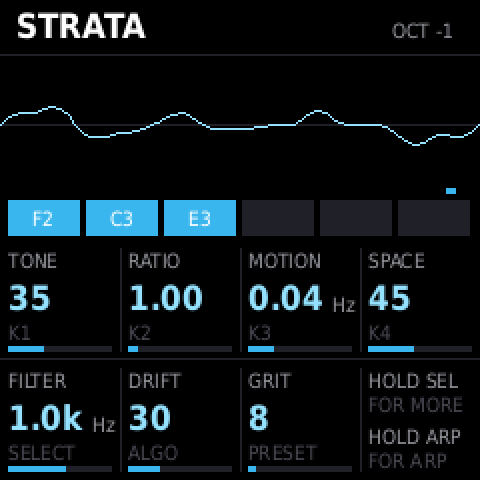
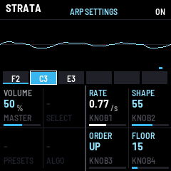
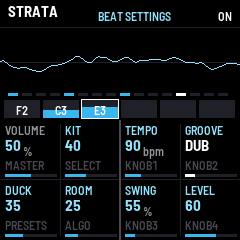
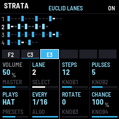

# STRATA

STRATA turns the M-VAVE FM-1 into a drone and texture synth with one mode and no menus. Tap a key and a voice fades
in and keeps going; tap it again and it fades away. Every knob changes the sound while it plays.

It's custom firmware, installed at your own risk. The installer can always put M-VAVE's own firmware back.

---

## Installing

It takes about a minute from a computer, with nothing to download.

1. On a computer, open the [installer](../install/) in **Chrome or Edge**. Safari and Firefox can't talk to the FM-1.
2. Plug the FM-1 in with a USB cable that carries data (some charging cables don't), and switch it on.
3. Click **Connect** and allow MIDI access when the browser asks.
4. Click **Install**. Keep the cable in and the FM-1 on until the page says it's done.
5. The FM-1 restarts and the screen says **STRATA** at the top.

**To go back to M-VAVE's firmware:** use the installer's "Back to the stock firmware" link, or M-VAVE's M-UPGRADE
app from m-vave.com.

You can also [try STRATA in the browser](../emu/) first, with sound. It's the same code, so you don't need an FM-1.

---

## Quick start

You'll have a drone going in under 30 seconds.

1. Turn **MASTER** (volume) up.
2. Tap a low key, then a key seven notes above it. Two voices fade in and keep going.
3. Turn **KNOB4** for more reverb, and **KNOB1** to make it brighter.
4. Press **PLAY** to fade everything out. Press it again to bring the same notes back.

---

## Playing

Keys start and stop voices, and you don't hold them down.

- **Tap a key** to start a voice at that note. It fades in and keeps sounding after you let go.
- **Tap the same key again** to let that voice fade out.
- Up to **six voices** play at once. A seventh replaces the oldest one, with a short crossfade.
- **PLAY** fades every voice out and remembers the chord. Press it again to bring that chord back.
- **OCT− / OCT+** move the keys down or up an octave. Voices already playing stay where they are.
- **MASTER** is the volume.

The keys that are sounding light up. A key that's still fading out glows dimly, and PLAY glows green while anything
is sounding.

---

## The screen

The screen has three parts, top to bottom.

- **Top:** STRATA and the keys' octave (OCT −1 to start). Messages show here for a moment, like "C3 IN" or "SAVED".
  While SEL is held it says **MORE**.
- **Middle:** the sound's wave, with a small dot sliding underneath that follows the slow LFO (MOTION). Below that
  are six boxes, one per voice, showing the note. A box fills as loud as that voice is.
- **Bottom:** eight boxes, placed the way the knobs sit on the FM-1. The left half is the four knobs to the left of
  the screen: MASTER (the volume) and SELECT on top, PRESETS and ALGORITHM under them. The right half is KNOB1 to
  KNOB4, two on top and two below. Each box shows what the knob sets, its value, the knob's name as printed on the
  panel (ALGORITHM is shortened to ALGO), and a bar. The box you're turning lights up.

---

## The knobs

All seven knobs change the sound live, and holding **SEL** gives you seven more on the same knobs. Turn slowly for
fine steps, or quickly to cover the whole range.

**Main controls** (just turn the knob):

| Knob | Control | What it does | Range |
| --- | --- | --- | --- |
| KNOB1 | **TONE** | Brightness of the FM: pure sine to glassy and buzzy | 0–100 |
| KNOB2 | **RATIO** | The FM ratio. Whole numbers sound harmonic; in between turns to bells and clangs | 0.5–7 |
| KNOB3 | **MOTION** | Speed of the slow LFO that makes the sound breathe | 0.01–3 Hz |
| KNOB4 | **SPACE** | How much reverb | 0–100 |
| SELECT | **FILTER** | Low-pass cutoff: dark and muffled to fully open | 40 Hz–14 kHz |
| ALGORITHM | **DRIFT** | Detunes each voice, lets pitch and level wander, widens the stereo | 0–100 |
| PRESETS | **GRIT** | Feedback in the FM: smooth at 0, rough and noisy near the top | 0–100 |

**Under SEL** (hold SEL and turn; let go to get back):

| Knob | Control | What it does | Range |
| --- | --- | --- | --- |
| KNOB1 | **DEPTH** | How far MOTION moves the tone and the filter | 0–100 |
| KNOB2 | **SHIMMER** | A slow beating shimmer between the voice's two halves | 0–3 Hz |
| KNOB3 | **FADE** | How long voices take to fade in and out | 0.1–20 s |
| KNOB4 | **DECAY** | How long the reverb rings, up to nearly endless | 1.5–60 s |
| SELECT | **RESO** | Filter resonance: a singing peak at the cutoff | 0–100 |
| ALGORITHM | **AIR** | Breathy noise, tuned to each voice's pitch | 0–100 |
| PRESETS | **SUB** | A sine one octave below each voice | 0–100 |

If you're not sure which physical knob is which, turn one and watch which box lights up on the screen.

---

## The arpeggiator

The arpeggiator plays the voices you've started one at a time, each swelling up while the others sink back. With
the slow default it sounds like a ripple through the chord, not a fast pattern.

- **Tap ARP** to switch it on or off. ARP lights up while it's on, and the screen says ARP at the top.
- **Hold ARP and turn KNOB1 to KNOB4** to set it up. The screen shows ARP SETTINGS. Letting go of ARP after a turn doesn't
  switch it off.
- The voice on the step has a white frame around its box on the screen.
- With only one voice playing, the arp pulses it on and off.
- Tap keys in and out while it runs; the arp picks up the change on the next step.

| Knob (ARP held) | Control | What it does | Range |
| --- | --- | --- | --- |
| KNOB1 | **RATE** | How fast it steps | 0.1–8 steps a second |
| KNOB2 | **SHAPE** | Sharp steps at 0, slow swells that blend into each other near 100 | 0–100 |
| KNOB3 | **ORDER** | UP (low to high), DOWN, UP-DN (up and back), RND (random) | 4 choices |
| KNOB4 | **FLOOR** | How loud the voices off the step stay: silent at 0, nearly full at 100 | 0–100 |

SAVE keeps whether the arp is on and its settings.

---

## The beat

The beat plays a drum groove under the drone: a synthesized kick, snare, hats, and a percussion voice tuned an octave
above your lowest note. The drone can duck under the kick, so the whole sound pumps in time.

- **Tap SEQ** to start or stop the beat. It always starts from the first step. SEQ flashes on the quarter notes
  while it runs, and sixteen small steps across the screen show where it is.
- **Hold SEQ and turn any of the seven knobs** to set it up. The screen shows BEAT SETTINGS. Letting go of SEQ after
  a turn doesn't stop it.
- While the beat or the lanes run, **the arp locks to the tempo**: RATE becomes a note length (1/1, 1/2, 1/4, 1/8, 1/16)
  instead of steps a second.

| Knob (SEQ held) | Control | What it does | Range |
| --- | --- | --- | --- |
| KNOB1 | **TEMPO** | Beats per minute | 60–160 bpm |
| KNOB2 | **GROOVE** | The pattern, one per click: PULSE, DUB, BREAK, HALF, TOMS, TICK, HEART, DRIVE | 8 grooves |
| KNOB3 | **SWING** | Straight at 50 %, heavy shuffle at 75 % | 50–75 % |
| KNOB4 | **LEVEL** | How loud the drums are | 0–100 |
| SELECT | **KIT** | Dark and low with long tails at 0, bright and snappy at 100 | 0–100 |
| ALGORITHM | **ROOM** | How much of the drums goes into the reverb (heard as much as SPACE lets it) | 0–100 |
| PRESETS | **DUCK** | How far the drone dips on each kick: none at 0, deep pumping at 100 | 0–100 |

The grooves:

| Groove | What it is |
| --- | --- |
| PULSE | Four on the floor, hats off the beat |
| DUB | One drop: kick and snare together on beat three |
| BREAK | A broken breakbeat |
| HALF | Half time, snare on three |
| TOMS | Kick and tuned toms rolling |
| TICK | Minimal: kick and small ticks |
| HEART | A slow lub-dub |
| DRIVE | Driving: kick on every beat, busy hats |

SAVE keeps whether the beat is on and its settings.

---

## The Euclidean lanes

A Euclidean lane spreads a number of hits as evenly as it can over a number of steps, and repeats. Four hits over
sixteen steps is a plain four-on-the-floor; five over twelve is a rolling pattern that never quite lines up with it.
STRATA has four lanes. Each one plays a drum, or steps the arpeggiator, and each can be a different length, so the
lanes drift against each other and the pattern keeps changing.

- **Tap EDIT** to switch the four lanes on or off. EDIT lights up while they're on, and the screen says EUC at the
  top.
- **Hold EDIT** to see and set them. The screen shows all four lanes as rows of blocks: a tall block is a hit, a low
  one is a rest, and the step playing now is white. Letting go of EDIT after a turn doesn't switch them off.
- A lane that plays a drum **takes over that drum from the beat's groove**. With the beat (SEQ) off, the lanes on
  their own are the drums. With the beat on, the groove still plays the drums no lane has taken.
- A lane set to **ARP** steps the arpeggiator once on each of its hits, instead of the arp's own RATE (which then
  shows EUC and the lane's number). With one voice playing, each hit is a pulse.
- The lanes share the beat's TEMPO and SWING. The clock starts from step one when the beat or the lanes start, and
  whichever is switched on second joins in without restarting it.
- The hit on a lane's first step is a little louder, so you can hear where each lane comes round.

| Knob (EDIT held) | Control | What it does | Range |
| --- | --- | --- | --- |
| SELECT | **LANE** | Which lane the other knobs set | 1–4 |
| KNOB1 | **STEPS** | How long the lane is | 1–32 |
| KNOB2 | **PULSES** | How many hits are spread over it | 0 to STEPS |
| KNOB3 | **ROTATE** | Moves the whole pattern later, a step at a time; it wraps round | 0 to STEPS − 1 |
| KNOB4 | **CHANCE** | How likely each hit is to play | 0–100 % |
| ALGORITHM | **EVERY** | How long one step is: 1/1, 1/2, 1/4, 1/8 or 1/16 | 5 lengths |
| PRESETS | **PLAYS** | OFF, KICK, SNARE, HAT, OPEN (open hat), PERC, or ARP | 7 choices |

The lanes start out as a kick (4 hits over 16), a hat (5 over 12), the arp (7 over 16) and a perc (3 over 9). SAVE
keeps whether the lanes are on and all four lanes' settings.

---

## The other buttons

Three more buttons do something besides PLAY, ARP, SEQ, EDIT and the octave buttons; the rest do nothing in STRATA.

- **REC = MUTATE.** Nudges the seven main controls a little in random directions. Press it a few times to wander
  somewhere new.
- **HOME, held for one second,** resets the sound to how it started. A quick tap only shows which version of STRATA
  is installed, so you can't reset by accident. It doesn't stop the voices. The version also shows for a moment at
  power-on.
- **SAVE** keeps the sound, the octave and the chord that's playing. They come back after you switch off, and PLAY
  starts the saved chord. SAVE stays lit while there's something new to save.

---

## Recipes

These are starting points; set the values you see on the screen, then play the notes listed. Anything not listed
can stay where it is.

| Sound | Main controls | Under SEL | Play |
| --- | --- | --- | --- |
| **Deep organ** | TONE 20, RATIO 1.00, FILTER 800, SPACE 40, DRIFT 20 | SUB 60, FADE 2 s | A low note and the note seven keys up |
| **Glass bells** | TONE 60, RATIO between 2.50 and 3.00, SPACE 70 | SHIMMER 0.5 Hz, DECAY 30 s, FADE 3 s | Three or four notes spread across the keys |
| **Dark storm** | GRIT 60, FILTER 300, MOTION 0.05 Hz, SPACE 80 | RESO 60, AIR 50, DEPTH 80, DECAY 60 s | One or two low notes, OCT− pressed once |
| **Shimmer pad** | TONE 40, RATIO 2.00, DRIFT 60, MOTION 0.20 Hz, SPACE 60 | SHIMMER 1.0 Hz | A chord of three notes |
| **Music box ripple** | TONE 45, RATIO 3.00, SPACE 70 | DECAY 20 s; ARP on: RATE 3/s, SHAPE 10, ORDER UP-DN, FLOOR 0 | Four notes going up the keys |
| **Night drive** | TONE 35, RATIO 2.00, FILTER 1.5k, SPACE 50 | ARP on: RATE 1/8, SHAPE 20; SEQ on: TEMPO 118, DRIVE, DUCK 60 | A minor chord of three notes |
| **Dub space** | TONE 25, RATIO 1.00, SPACE 80 | DECAY 30 s; SEQ on: TEMPO 72, DUB, SWING 60 %, ROOM 70, DUCK 40 | One low note and its fifth |
| **Drifting clockwork** | TONE 40, RATIO 2.00, SPACE 55 | ARP on, SHAPE 15; EDIT on with the lanes as they start (kick 4/16, hat 5/12, arp 7/16, perc 3/9); SEQ off | Three notes spread across the keys |
| **Slow tide** | TONE 25, RATIO 1.00, FILTER 1.0k, SPACE 60 | SUB 50; ARP on: RATE 0.3/s, SHAPE 90, FLOOR 30 | A low chord of three notes |

Once a recipe sounds right, press **SAVE** to keep it.

---

## MIDI

STRATA takes MIDI in over USB and the TRS jack, on any channel.

- **Notes** play voices while held, like a normal synth. The sustain pedal (CC 64) holds them.
- **CC 123** (all notes off) releases the MIDI voices.
- Keys tapped on the FM-1 go out over USB as notes, so a computer can record them.
- **CC 20 to 31 and CC 102 to 114** set the twenty-five controls. (Up to 0.4 they ran from CC 20 to 44, which
  included two numbers that computers and keyboards send on their own.)

| CC | Control | CC | Control | CC | Control |
| --- | --- | --- | --- | --- | --- |
| 20 | TONE | 29 | FADE | 108 | TEMPO (beat) |
| 21 | RATIO | 30 | DECAY | 109 | GROOVE (beat) |
| 22 | MOTION | 31 | RESO | 110 | SWING (beat) |
| 23 | SPACE | 102 | AIR | 111 | LEVEL (beat) |
| 24 | FILTER | 103 | SUB | 112 | KIT (beat) |
| 25 | DRIFT | 104 | RATE (arp) | 113 | ROOM (beat) |
| 26 | GRIT | 105 | SHAPE (arp) | 114 | DUCK (beat) |
| 27 | DEPTH | 106 | ORDER (arp) |  |  |
| 28 | SHIMMER | 107 | FLOOR (arp) |  |  |

---

## Troubleshooting

| Problem | Fix |
| --- | --- |
| No sound | Turn MASTER up and tap a key. If FADE is long, voices take that long to come in: hold SEL and turn KNOB3 down. |
| Sound is muffled | FILTER is low: turn SELECT up. |
| The installer can't find the FM-1 | Use Chrome or Edge, try another USB cable, and close other apps or pages that use MIDI. |
| The knobs do M-VAVE things | STRATA isn't installed yet: the screen should say STRATA at the top. |
| "OVERLOAD" on the screen | The sound took too long to make, so the oldest voice was let go. Use fewer voices or less AIR. |
| The voices pulse or take turns | The arp is on: tap ARP to switch it off. |
| Drums are playing | The beat or the lanes are on: tap SEQ or EDIT to stop them (the top of the screen says BEAT or EUC). |
| The arp ignores RATE | A lane is stepping it (RATE shows EUC): hold EDIT and set that lane's PLAYS to something else. |
| The drone pumps or dips | That's DUCK: hold SEQ and turn PRESETS down. |
| Want the original sound back | Hold HOME for a second. |
| Want M-VAVE's firmware back | Use the installer's "Back to the stock firmware" link. |

M-VAVE and FM-1 are trademarks of their owners; STRATA isn't affiliated with M-VAVE.
