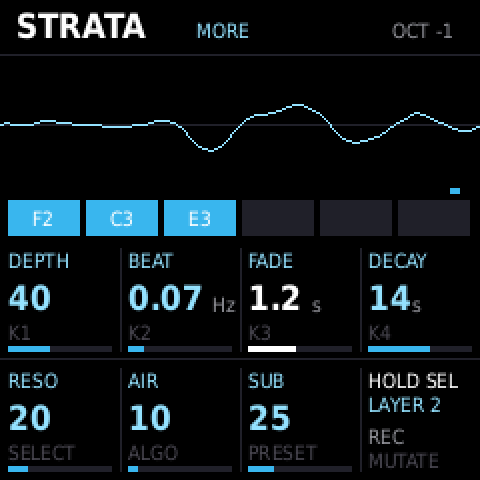

# STRATA

STRATA is a drone and texture synth for the M-VAVE FM-1. It has one mode: you start long, slowly moving voices
from the keys and shape them with the knobs while they play. Nothing is hidden in menus.

---

## 1. Install

1. On a computer, open the [installer](../install/) in **Chrome or Edge**. Safari and Firefox can't talk to the
   FM-1.
2. Plug the FM-1 in with a USB cable that carries data (some charging cables don't). Switch it on.
3. Click **Connect**, allow MIDI access when the browser asks, then click **Install**. Keep the cable in and the
   FM-1 switched on until the page says it's done. That's about a minute.

To go back to M-VAVE's firmware, use the installer's "Back to the stock firmware" link, or M-VAVE's M-UPGRADE
app from m-vave.com.

---

## 2. Playing

- **Tap a key** to start a voice at that note. It fades in and keeps sounding after you let go.
- **Tap the same key again** to let that voice fade out.
- Up to **six voices** play at once. A seventh replaces the oldest one, with a short crossfade.
- **PLAY** fades every voice out and remembers the chord. Press it again to bring that chord back.
- **OCT− / OCT+** move the keys down or up an octave. Voices already playing stay where they are.
- **MASTER** is the volume.

The keys that are sounding light up. A key that's still fading glows dimly.

---

## 3. The screen

- **Top:** the name, and the keys' octave. Messages appear here for a moment.
- **Middle:** the sound's wave, and a small dot for the slow LFO (MOTION). Below that are the six voices. Each
  one shows its note, and its box fills as loud as it is.
- **Bottom:** the seven controls, laid out like the knobs: K1 to K4 on the top row, SELECT, ALGO and PRESET
  below. Each shows its value and a bar.

---

## 4. The knobs

All seven are live. Turn a knob slowly for fine steps, or quickly to cover the range.

| Knob | Control | What it does |
| --- | --- | --- |
| K1 | **TONE** | How bright the FM is: from a pure sine to glassy and buzzy |
| K2 | **RATIO** | The FM ratio. Whole numbers (1, 2, 3) sound harmonic. Between them it turns to bells and clangs |
| K3 | **MOTION** | How fast the slow LFO moves, from 0.01 Hz (100 seconds a cycle) to 3 Hz |
| K4 | **SPACE** | How much reverb |
| SELECT | **FILTER** | The low-pass cutoff, from 40 Hz to 14 kHz |
| ALGO | **DRIFT** | Detunes the voice and lets its pitch and level wander, and widens the stereo |
| PRESET | **GRIT** | Feedback in the FM: smooth at 0, rough and noisy near the top |

**Hold SEL** for seven more on the same knobs. Let go of SEL to get back.

| Knob | Control | What it does |
| --- | --- | --- |
| K1 | **DEPTH** | How far MOTION moves the tone and the filter |
| K2 | **BEAT** | A slow beating shimmer, from 0 to 3 Hz |
| K3 | **FADE** | How long voices take to fade in and out: 0.1 to 20 seconds |
| K4 | **DECAY** | How long the reverb lasts, from 1.5 seconds to nearly endless |
| SELECT | **RESO** | Filter resonance |
| ALGO | **AIR** | Breathy noise, tuned to each voice |
| PRESET | **SUB** | A sine one octave below each voice |

---

## 5. The other buttons

- **REC** is MUTATE. It nudges the seven main controls a little in random directions. Press it a few times to wander
  somewhere new.
- **HOME, held for a second,** puts the sound back to how it started. A quick tap does nothing, so you can't hit it
  by accident.
- **SAVE** keeps the sound, the octave and the chord that's playing. They come back after you switch off, and PLAY
  starts the saved chord. SAVE stays lit while there's something new to save.

The other buttons do nothing in STRATA.

---

## 6. MIDI

STRATA takes MIDI in over USB and the TRS jack, on any channel.

- **Notes** play voices while they're held, like a normal synth. The sustain pedal (CC 64) holds them.
- **CC 20 to 33** set the fourteen controls in the order of the tables above: CC 20 is TONE, CC 26 is GRIT, CC 27
  is DEPTH, and CC 33 is SUB.
- **CC 123** (all notes off) releases the MIDI voices.
- Keys tapped on the FM-1 are sent out over USB as notes, so a computer can record them.

---

## 7. Troubleshooting

- **No sound:** turn MASTER up, and tap a key. FADE may be long: with FADE at 20 s, a voice takes that long to come
  in. Hold SEL and turn K3 down.
- **The installer can't find the FM-1:** use Chrome or Edge, try another USB cable, and close other apps that use
  MIDI, such as a DAW or another editor page.
- **"OVERLOAD":** the sound took too long to make, so the oldest voice was let go. Fewer voices or less AIR helps.
