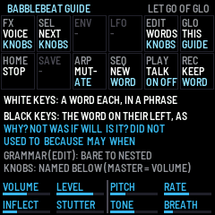
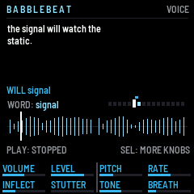
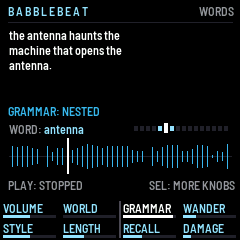

# BabbleBeat

**A word on every key, and a tiny robotic voice.** A third FM-1 firmware beside STRATA and PALINDROME. Sentences are built by grammar rules; the voice is a formant robot that says only the words it knows.

Custom firmware, installed at your own risk. It has not run on a real FM-1 yet. [Install](../install/) · [Try it in the browser](../emu/).

## Quick start

1. Press a **white key**. It has a word, and says a phrase about it. Press it again: the same phrase, now and then a new one.
2. Press the **black key** to its right: the same word in another kind of phrase (a question, a "not", a "was").
3. Keep playing keys. A word stays on its key; now and then it moves to the next word of its world.
4. **SEQ** puts a new word on the key. **REC** remembers the key's word; RECALL brings it back into other phrases.
5. **PLAY** babbles about the key's word; **HOME** stops.
6. **EDIT**, then **GRAMMAR** (KNOB1): every phrase is built another way, bare to nested.
7. **SEL** steps through the three sets of knobs: VOICE, MOUTH, WORDS. Lost? Hold **GLO**.

## Buttons

| Button | Action |
| --- | --- |
| PLAY | Babble: one phrase after another about the key's word |
| SEQ | A new word on the key, and a phrase about it |
| ARP | The key's phrase made again |
| REC | Remember the key's word |
| SEL | The next set of knobs: VOICE → MOUTH → WORDS |
| FX | VOICE knobs |
| EDIT | WORDS knobs |
| HOME | Stop speaking and turn off the babble |
| OCT- / OCT+ | The whole voice down or up an octave |
| GLO (hold) | The guide: what every button does, on the screen |
| SAVE, ENV, LFO | Not used; the screen says so |

## Keys

**A white key is a word.** The sixteen take the nouns of the WORLD in order, so neighbouring keys are neighbouring words. A key says a plain statement about its word and keeps it, so you can come back to it. Lower keys speak in a lower voice. The screen shows `WORD:` and a row of sixteen marks, the tall one the key in use.

**A black key is a kind of phrase.** It uses the word of the white key on its left:

| Black key, left to right | Kind | Example with *mirror* (GRAMMAR at PLAIN) |
| --- | --- | --- |
| 1 | **WHY?** | why does the mirror haunt the static? |
| 2 | **NOT** | the mirror does not follow the machine. |
| 3 | **WAS** | the mirror was silver inside the signal. |
| 4 | **IF** | if the mirror dreams, the filter watches the voltage. |
| 5 | **WILL** | the mirror will forget the circuit. |
| 6 | **IS IT?** | does the mirror haunt the engine? |
| 7 | **DID NOT** | the mirror did not corrupt the voltage. |
| 8 | **USED TO** | the mirror used to corrupt the static. |
| 9 | **BECAUSE** | the mirror watches the signal because the terminal sings. |
| 10 | **MAY** | the mirror may follow the voltage. |
| 11 | **WHEN** | when the mirror vanishes, the antenna will forget the engine. |

## GRAMMAR

GRAMMAR (EDIT, KNOB1) sets how **every phrase on the unit** is built: white keys, black keys and PLAY's babble. There are five levels. Turn across one and the phrase on the screen is built again that way and said; each other key follows when it is next played. The screen names the kind and the level under the phrase, for example `WHY?  NESTED`.

| GRAMMAR | Level | A white key | The WHY? key | The NOT key |
| --- | --- | --- | --- | --- |
| 0–19 | **BARE** | the strange mirror. | why the mirror? | not the mirror. |
| 20–39 | **SIMPLE** | the mirror vanishes. | why is the mirror silver? | the mirror is not synthetic. |
| 40–59 | **PLAIN** | the mirror watches the static. | why does the mirror haunt the static? | the mirror does not follow the machine. |
| 60–79 | **JOINED** | the mirror waits, but the filter forgets the engine. | why does the mirror watch the signal, and why does the circuit sleep? | the mirror does not swallow the engine, and the engine does not whisper. |
| 80–100 | **NESTED** | the mirror that opens the robot returns. | why does the mirror that waits watch the speaker when the terminal sleeps? | the mirror that waits does not haunt the robot because the robot is not pale. |

**What changes, and how fast**

| Knob (WORDS) | Sets |
| --- | --- |
| **WANDER** | How often a key's word moves when you play it. It moves one step, to the next word of its world, never a jump. At 0 it never moves |
| **DAMAGE** | How often a key's phrase is made again when you play it. At 0 a phrase stays until you change it. Past 60 it may be broken instead (a word doubled, dropped, an "again") |

When a white key's word moves, the black key beside it follows the next time it is played.

## WORDS — EDIT

| Knob | Control | Function |
| --- | --- | --- |
| KNOB1 | **GRAMMAR** | How every phrase on the unit is built: BARE, SIMPLE, PLAIN, JOINED, NESTED |
| KNOB2 | **WANDER** | How often a key's word moves a step; also, other nouns borrowed from outside the world |
| KNOB3 | **RECALL** | How often the remembered word returns. Past 70 the phrases fix on it and loop back on themselves: "the mirror was, the mirror was pale." |
| KNOB4 | **DAMAGE** | How often a key's phrase is made again as it is played; past 60 it may be broken instead |
| SELECT | **WORLD** | Machine, Dream, Body or Gothic/Dracula vocabulary, for keys that have no word yet |
| ALGORITHM | **LENGTH** | High values can append a further clause (from PLAIN up) |
| PRESETS | **STYLE** | Statements at low values; mixed in middle; questions at high values |

## VOICE — FX

| Knob | Control | Function |
| --- | --- | --- |
| KNOB1 | **PITCH** | Base pitch for automatic speech |
| KNOB2 | **RATE** | Phoneme length / speaking speed |
| KNOB3 | **TONE** | A darker, larger voice to a brighter, smaller one |
| KNOB4 | **BREATH** | Breath noise in the voiced sounds |
| SELECT | **LEVEL** | Synthesizer voice volume |
| ALGORITHM | **STUTTER** | Repeat individual pronunciation codes |
| PRESETS | **INFLECT** | How much the pitch moves: a lift on each word, a fall at the end, a rise for a question |

## MOUTH — SEL

SEL steps VOICE → MOUTH → WORDS. The middle of each MOUTH knob is the voice as it is made.

| Knob | Control | Function |
| --- | --- | --- |
| KNOB1 | **SIZE** | A small mouth (every resonance higher) to a large one |
| KNOB2 | **SLUR** | Crisp, to sliding lazily from sound to sound |
| KNOB3 | **GAP** | The quiet between words: run together, to spaced out |
| KNOB4 | **WAVER** | How much the pitch trembles |

MASTER always controls volume.

## How the sentence engine works

A compact lexicon tags parts of speech. There are twelve kinds of phrase (the statement and the eleven black-key kinds), and each has a form at each of GRAMMAR's five levels. Statements use third-person verbs, and base verbs follow "does", "did", "will" and "may". Verbs that take no object are never given one.

REC keeps a word in a small memory slot; RECALL governs whether a later phrase uses it. WORLD decides the nouns; WANDER can cross worlds. LENGTH can add a further clause. DAMAGE past 60 lets tokens repeat, disappear or be interrupted by "again".

The four themed banks loosely echo an earlier Python WordNet/Dracula experiment. BabbleBeat does not include WordNet, a full novel or live dictionary downloads.

## Voice limitations

The voice is a small formant synthesizer with a hand-phonemized word list:
a glottal pulse and breath noise through four gliding formants, with shaped
noise for hisses and stops. It is robotic on purpose, and it is
not a general English TTS engine or CHIMERA's modeled vocal tract.
There is no text input, no recording, no save/load of patches and no MIDI
support in the app yet. The firmware has not run on a real FM-1: the first
trials must establish intelligibility.
