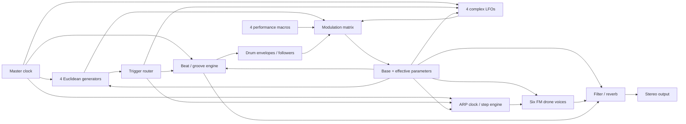

# STRATA — Generative Modulation & Euclidean Rhythm Design

**Status:** Design proposal / implementation roadmap  
**Baseline:** STRATA v0.3 (six latched FM drone voices, ARP, eight synthesized drum grooves)  
**Scope:** Standalone performance on the M-VAVE FM-1 and its browser emulator.

## Implementation status

**0.4** ships stage 1 and the first part of stage 2:

- The beat's clock is now a shared transport: it runs while the beat or any lane needs it, starts from step one when
  the first of them starts, and the other joins without a restart. The arp locks to it whenever it runs.
- Four Euclidean lanes on EDIT (tap: on / off; hold: edit). Per lane: steps 1–32, pulses, rotation, chance, step
  length (1/1 to 1/16) and a target. Masks are precomputed; `E(p, n)` puts a hit on step `i` when
  `(i * p) mod n < p`, so rotation 0 has a hit on step one, and rotation moves the pattern later.
- Targets: a drum (kick, snare, closed hat, open hat, perc) in **Replace** mode only, or the arp's step (advance on
  each accepted hit; one voice alone pulses for half a lane step).
- The hit on a lane's first step is accented. Chance uses a per-lane generator, reseeded at each transport start.

Not yet: Add and Mask drum modes, accent patterns and strength, gate length, invert, per-lane swing, quantized edits,
lane-to-LFO triggers, and stages 3–5. Nothing here has been measured on hardware yet (section 11).

## 1. Vision

STRATA should evolve from a drone synthesizer with an arpeggiator and drum machine into a generative performance instrument: an interconnected sound, modulation and rhythm system that can produce evolving music while the player casually turns knobs.

The next major development should be built around four equally important systems:

| System | Purpose |
| --- | --- |
| Complex LFOs | Continuous, cyclic, irregular and chaotic modulation |
| Euclidean generators | Rhythmic gates, triggers and polymetric patterns |
| Macro knobs | Immediate control of multiple parameters together |
| Modulation matrix | Connections between sound, rhythm, macros and modulation sources |

The existing philosophy is important: every knob is live, the player should not need a computer or external MIDI, and complex editing is optional. A user should be able to latch a chord, start a groove, turn a few knobs, and hear an entire piece evolve. This is not a proposal to replace the current synthesis engine or make a full DAW.

### Design principles

- Keep the existing main and SEL sound-control layers intact by default.
- Preserve the existing ARP and SEQ behavior as usable modes; don't replace the fixed grooves.
- Make each new subsystem independently usable with the others disabled.
- Settings belong to individual LFOs and Euclidean generators, not a single shared set.
- Connections are many-to-many; one generator can drive multiple destinations.
- Use non-destructive modulation. The underlying sound remains recoverable.
- All time-based features can share a common clock, but slower autonomous modulation is also valuable.
- Front-panel usability, sound quality and uninterrupted audio matter more than the number of features.
- Avoid requiring the browser or MIDI for configuration. The emulator should provide the same controls and behavior as the device.

## 2. System architecture



The master clock provides timing events; the trigger router handles discrete events such as drum hits, ARP steps and LFO resets; the modulation matrix handles continuous or held values. These are related but distinct. A Euclidean pulse is both a trigger event and, when configured, the start of a modulation gate.

The current beat engine already has a sample-counted sixteenth-note clock. Extract that into a reusable transport without changing the fixed-groove sound. The transport must remain available when the drums are muted or turned off, allowing an ARP or Euclidean LFO rhythm without audible drums.

### Master clock

- Initial range: retain the current 60–160 BPM; consider a wider range after usability testing.
- Global swing: retain the existing straight-to-shuffle range (50–75%).
- Provide beat, bar, sixteenth and selectable musical divisions/multiplications.
- Keep free-running clocks available for LFOs and ARP.
- Starting/stopping drums should not implicitly reset unrelated running modulators; provide an intentional transport/reset action.
- Define phase/restart behavior for individual generators and for the whole instrument.
- Maintain fractional sample timing to avoid cumulative drift; do not make timing dependent on UI frame rate.

## 3. Four independent complex LFOs

The current MOTION control drives a single sine LFO that sweeps FM index and global filter cutoff, with phase offsets across voices. Keep this recognizable behavior as a default/legacy configuration. The new LFO engine should be far more flexible.

### Waveforms and algorithms

| Source | Description |
| --- | --- |
| Sine | Classic smooth, cyclical modulation |
| Triangle | Linear rise and fall |
| Ramp up / down | Directional motion, useful for sweeps |
| Square / pulse | Alternating values; adjustable duty cycle |
| Sample & hold | Random value held until the next trigger or cycle |
| Smooth random | Interpolated random values; continuous wandering |
| Random walk | Bounded incremental movement with memory |
| Chaos | Bounded irregular, semi-periodic nonlinear motion |
| Compound | Two component oscillations combined through AM, phase modulation, folding or mixing |

The first implementation can use sine, triangle, ramp, pulse, sample & hold and smooth random. Add chaos and compound waveforms in a later pass, once their musical behavior and CPU cost are understood. A sum of independent sine waves is compound modulation, not by itself a chaotic system. Candidate chaotic sources include a bounded logistic map with suitable smoothing, or Lorenz/Rössler dynamics at a fixed control-rate integration step.

### Per-LFO settings

| Setting | Proposed behavior |
| --- | --- |
| Waveform | Select an algorithm |
| Rate | Free Hz/period or tempo-synchronized musical division |
| Depth | Output magnitude, 0–100% |
| Phase | 0–360° starting offset |
| Shape | Shape-specific control: pulse width, slew, fold, etc. |
| Clock mode | Free, sync, triggered/one-shot |
| Scope | Global, voice-phase-offset, or independent per-voice |
| Retrigger | None, note-on, transport reset, or routed trigger |
| Polarity | Bipolar or unipolar |
| Random seed | Repeatable or fresh-on-reset behavior (advanced) |

Aim for rates from several-minute cycles (e.g. 0.003 Hz) up through rhythmic LFOs (e.g. 20 Hz), with logarithmic control. These are proposed targets, not verified hardware limits. Audio-rate modulation is outside the first pass.

**Global** scope shares a value across voices. **Phase-offset** scope uses one clock but different phase per slot or note. **Independent** scope gives each active voice its own phase/algorithm state and random stream where appropriate. Define the behavior for newly latched/stolen voices. Global destinations such as the shared filter and reverb must have a defined global source or aggregation; per-voice filter cutoff would require separate filters and should be deferred until profiled.

### Cross-modulation

Allow one LFO to modulate another LFO's rate, depth, phase offset or shape. For example, slow random modulation of a second LFO's rate yields breathing that never feels mechanically repetitive. Future sources could include coupled oscillators, a bounded random walk, clock dividers, Bernoulli triggers and multi-axis chaotic systems.

Support cross-modulation without recursive evaluation: use previous-control-tick source snapshots for feedback routes or reject cycles in the initial version. Choose and document a deterministic evaluation order. Bound rates and depth at all times.

## 4. Four independent Euclidean pattern generators

The Euclidean system is a core rhythm and modulation source, not merely a new drum preset. Each generator distributes a chosen number of pulses across a chosen number of steps as evenly as possible and repeats the result. The Bjorklund algorithm or a mathematically equivalent evenly distributed construction is suitable. Normalize the initial phase/rotation convention and use it consistently.

Notation: **E(pulses, steps)**. A conventional example, with one pulse at step zero:

```text
E(4,16)  X...X...X...X...
E(3,8)   X..X..X.
E(5,16)  X...X..X..X..X..
```

X = hit; dot = rest. Equivalent rotated patterns are valid; the implementation must document which rotation is zero.

### Per-generator settings

| Setting | Range or meaning |
| --- | --- |
| Enabled | On/off independently |
| Steps | 1–32 initially |
| Pulses | 0–Steps, inclusive |
| Rotation | 0–Steps−1; circular shift |
| Clock division | Independent musical division/multiplication of master clock |
| Probability | 0–100%, chance of accepting each hit |
| Gate length | 1–100% of local step duration |
| Accent pattern | Every N accepted hits or a separate evenly distributed accent mask |
| Accent strength | 0–100% |
| Swing | Follow master swing; optionally independent later |
| Invert | Swap hits and rests before probability filtering |
| Reset behavior | Transport start, manual reset, or free-running phase |
| Destinations | One or more routed trigger or modulation consumers |

Use four lanes initially, EUC 1–4. Each lane has its own cycle length, cursor, phase, settings, seed and generated mask. The lanes share a reference tempo but are not forced to restart at every bar. Different lengths (e.g. 16, 12, 9) and clock divisions create polymetric patterns that change their relationship over many bars.

### Example patch

```text
Kick             E(4,16)  X...X...X...X...
Hi-hat           E(5,12)  X..X.X..X.X.  (12-step cycle)
Arpeggiator      E(7,16)  X..X.X.X..X.X.X.
Filter / LFO     E(3,9)   X..X..X..
```

All four cycles can run together with different rotation and probability. Display each independently. These are illustrative masks; use the canonical generator, rather than hand-coded examples, in implementation.

### Pattern change semantics

- Length and pulse count are integers. Clamp pulses when length shrinks; wrap rotation.
- Zero pulses = no triggers; pulses equal to length = a hit on every step.
- Pulse distribution and rotation must be deterministic given the settings.
- Recompute only when discrete settings change; use precomputed bitmasks within the timing/audio loop.
- Apply edits live at a step boundary without emitting an extra trigger, then retain/wrap the local playhead.
- Offer optional cycle-boundary updates for performance changes that should be quantized.
- Probability is evaluated once per eligible hit using per-lane PRNG state; accents do not create extra hits.
- Inversion, probability and accent ordering must be explicit. Recommended: base mask → rotation → invert → probability → accent/velocity → gate.
- Gate duration should be latched from the current step duration so tempo/swing changes don't strand a gate. If high gates overlap, define whether a new hit retriggers or extends the gate.
- Keep triggers, gate state, accents and optional step phase as separate outputs. A clock tick is not necessarily a hit.

### Combining patterns

Future logic routing may combine two or more patterns in AND, OR, XOR or NOT modes. Define the evaluation grid carefully: OR combines coincident events once, AND requires overlapping event windows or coincident grid ticks, XOR excludes coincident events, and NOT samples rests on a specified local clock (it must not emit a trigger on every audio sample). Distinguish combinations of trigger events from combinations of sustained gate signals. Do not require this feature for the initial Euclidean release.

## 5. Beat, ARP and LFO integration

### Drum / groove engine

Keep the current synthesized kick, snare, closed hat, open hat and tuned percussion, and its eight preset grooves (PULSE, DUB, BREAK, HALF, TOMS, TICK, HEART, DRIVE). Expose drum-hit dispatch independently of the 16-step preset lookup. A lane can target any drum voice or several at once. This allows the user to build beats from scratch, or elaborate a groove.

Per-target combination policy:

| Mode | Behavior |
| --- | --- |
| Add | OR a lane's hits into the existing groove |
| Mask | Keep groove hits only if the selected lane permits them |
| Replace | Use the lane instead of the groove for that instrument |
| Off | Fixed groove remains unaffected |

Merge duplicate hits at the same instant before triggering the instrument. Preserve accent/velocity information and the open/closed hi-hat choke behavior. Kick-driven ducking should work whether the kick comes from a preset or Euclidean lane. Keep ROOM, KIT, LEVEL and DUCK live. Provide drum mute/level independently from transport so silent rhythmic sources still operate.

Later possibilities: per-instrument density, variations, fills, accent maps, multiple lane routing, and macro-controlled groove mutation.

### Arpeggiator

Retain current UP, DOWN, UP-DOWN and RANDOM note-order modes, SHAPE and FLOOR. Add an explicit ARP clock-source setting:

- FREE: current free-running rate.
- SYNC: evenly spaced musical division of the master clock.
- EUC 1–4: advance on the selected lane's accepted trigger; independent lane clock determines the rhythm.

RATE can retain its current meaning in FREE/SYNC mode. In EUC mode it should display the lane or optionally act as a documented input divider, rather than silently doing nothing. Decide whether each Euclidean gate holds the selected note or merely advances the existing swell; provide an explicit gate-follow option so users can choose sustained ripples or pulsed phrases.

Single-voice ARP should still pulse rather than become permanently silent. Adding/removing latched notes while an external trigger source is selected must not produce unintended steps. A rest should hold or release according to the chosen gate mode, not advance the note. The legacy beat-synced ARP should continue working.

### LFO triggering

Each Euclidean lane can independently route to LFO 1–4 with a defined trigger action:

| Action | Effect |
| --- | --- |
| Reset phase | Restart at the configured phase |
| One-shot | Run one waveform cycle and return to its defined resting value |
| Sample | Capture the current source value into a hold output |
| Random advance | Select the next sample-and-hold/random-walk target |
| Gate | Enable the source or scale its amplitude for the gate duration |

An LFO may also use the master clock without Euclidean triggers, free-run, or run at its own tempo division. Example: EUC 3 fires 7/16 to advance the arp while EUC 4 fires 3/9 to reset a filter modulation oscillator. Their relationship produces a shifting accent pattern without changing the notes.

### Direct modulation

A lane's gate, held accent or pulse envelope can be a modulation source in the same matrix as an LFO. Smooth gate edges with a configurable short attack/release for continuous audio parameters. This allows rhythmic pulses to affect FM tone, cutoff, resonance, pitch, amplitude, panning, reverb sends or macro values. A stepped parameter such as pulse count must quantize at a safe boundary.

## 6. Performance macro knobs

Four macros on K1–K4, accessible through a dedicated performance layer. Each macro has its own name, position, list of assignments, signed depth per assignment, and optional mapping curve. Multiple macros may target the same parameter. Turning a macro must not overwrite the underlying sound; returning it to its neutral position must restore the base sound plus any other active modulation.

Start with unipolar 0–100% macros with zero neutral. Optionally allow bipolar macros later. Initial library of useful assignments (illustrative normalized offsets, not hardcoded sound requirements):

| Macro | Example destinations and amounts at 100% |
| --- | --- |
| DENSITY | TONE +45%, AIR +55%, SUB −20%, RESO +30% |
| EVOLUTION | LFO depth +75%, DRIFT +70%, random variation +90%, LFO rate +35% |
| TENSION | GRIT +85%, RATIO +45%, FILTER −45%, detune +70% |
| IMMERSION | SPACE +80%, DECAY +85%, stereo width +70%, drum LEVEL −50% |

An alternate COMPLEXITY macro might increase hat and arp pulse density, accent variation, LFO reset frequency and FM depth. These names/mappings are editable templates; only map to implemented destinations. In particular, independent stereo width and detune may require new underlying parameters.

Macros can target Euclidean pulses, rotation, probability, clock division or accent strength. They can also target LFO depth/rate/shape, and ARP/beat parameters. Discrete targets should update on step boundaries and use quantization/hysteresis so small changes don't flicker between adjacent values. Support LFO/Euclidean modulation of macro values as an optional extension using the same bounded/feedback-safe evaluation rules.

Optional macro features: momentary snap-back, macro morphing between two complete sound scenes, per-route min/max ranges, exponential response curves, and selective mutation. Defer these until basic macro routing is usable.

## 7. Modulation matrix

### Source types

- LFO 1–4, in their configured global/per-voice scope.
- EUC 1–4 gate, accent, held value, or smoothed pulse.
- Macro 1–4.
- Voice envelope, independent voice phase or voice random value.
- Drum kick/snare/percussion envelope or signal follower (later).
- Master clock subdivisions, external triggers, additional random sources (later).

### Destination types

| Domain | Examples |
| --- | --- |
| FM voice | Tone/index, ratio, grit/feedback, pitch, stereo position, sub, air, amplitude |
| Global effects | Filter, resonance, reverb mix, decay |
| ARP | Rate/division, shape, floor, order |
| Drums | Tempo (restricted), level, kit, room, duck, accent/density |
| LFO | Rate, depth, shape, phase offset |
| Euclidean | Pulses, rotation, probability, accent strength, gate length, clock division |
| Macros | Macro position (optional advanced routing) |

Distinguish continuous modulation (e.g. filter cutoff), discrete modulation (e.g. number of steps), and triggers (e.g. advance ARP), including their compatible source types, scopes and update rates. Existing hardware does not currently provide separate per-voice filters or all suggested destinations; implement new targets intentionally, don't imply they already exist.

A route contains a source ID, destination ID (including lane/voice scope where needed), signed amount, polarity, enabled flag and optional response curve. Use fixed-size tables, starting at a bounded budget such as 32 modulation routes and 16 trigger routes; verify memory and CPU before committing to larger counts.

### Parameter evaluation

Conceptually:

```text
base_value        = persisted / manually edited parameter
macro_offset      = sum of applicable macro contributions
modulation_offset = sum of applicable source contributions
effective_value   = constrain(base_value + macro_offset + modulation_offset)
output_value      = map effective normalized value to physical units, smooth if appropriate
```

Apply bipolar/unipolar conversion explicitly. Use parameter-specific curves, not generic raw-Hz addition; retain the existing logarithmic control mappings where relevant. Pitch may use semitone/cent units and cutoff may use octave offsets. Preserve base values even when effective values saturate. Use per-destination limits and smoothing to prevent unstable filter/reverb feedback or clicks. Persistent settings represent base values and routing configuration, never transient modulated values.

Event routing is separate: clock/Euclid ticks dispatch into drum hits, ARP advance, LFO resets or envelopes. Do not emulate a discrete trigger by repeatedly writing a continuous modulation parameter.

Suggested control-tick order:

1. Snapshot panel/base settings and previous modulation source states.
2. Evaluate permitted macro offsets and bounded control-rate dependencies.
3. Advance clock and generate time-stamped rhythmic events; apply discrete changes at defined boundaries.
4. Dispatch triggers and update LFO/gate/envelope state.
5. Compute effective continuous parameters from sources and macros; smooth where appropriate.
6. Render voices, drums and shared effects. Publish a read-only UI telemetry snapshot.

This is a dependency model rather than a mandatory single function. Sample-accurate trigger placement can coexist with block-rate calculation of continuous modulation. Feedback connections must use an explicit prior-tick value (or be disallowed initially), including tempo and self-modulating patterns. Never recursively traverse an unbounded graph in the audio callback.

## 8. Hardware & UI concept

The FM-1 has unused buttons. Extend the existing tap/hold control system rather than introduce a mandatory menu tree.

| Button | Proposal |
| --- | --- |
| SEL | Keep original secondary sound controls |
| ARP | Keep ARP toggle and adjustment layer; add clock-source settings |
| SEQ | Keep beat toggle and adjustment layer; add Euclidean drum-source selection |
| LFO | Access/select complex LFOs; hold for live settings |
| GLO | Access the performance macro layer |
| EDIT | Access Euclidean generators; secondary edit action for modulation/routing |
| FX | Reserved for additional sound processing |
| ENV | Reserved for future envelope shaping |
| REC | Keep MUTATE; later permit selective modulation of mutation amount |
| SAVE | Persist the complete sound and generative patch |
| HOME | Preserve long-hold sound reset; provide safe reset/clear operations for new layers |

Exact button gestures should be prototyped in the browser. Do not overload EDIT with ambiguous tap/hold semantics. One possible interaction: tap EDIT to select a persistent EUC page, hold EDIT for temporary Euclidean control, and use a deliberate secondary chord for routing. Provide an obvious exit to normal sound controls. Holding a layer to change a knob should not accidentally toggle another subsystem.

### Euclidean page — proposed primary assignment

| Encoder | Parameter |
| --- | --- |
| K1 | Steps |
| K2 | Pulses |
| K3 | Rotation |
| K4 | Probability |
| SELECT | Generator 1–4 |
| ALGO | Clock division |
| PRESET | Accent strength |

Secondary Euclidean page: enable, gate length, accent pattern, invert, swing, reset, destination/merge mode. Provide a clear one-handed way to select a page or latch the settings view; the rhythm should continue while editing.

### LFO page — proposed primary assignment

| Encoder | Parameter |
| --- | --- |
| K1 | Rate |
| K2 | Depth |
| K3 | Waveform |
| K4 | Shape |
| SELECT | LFO 1–4 |
| ALGO | Phase |
| PRESET | Free/sync/trigger mode |

Secondary LFO controls: scope, reset source/action, polarity, and optional seed. Show a compact waveform preview, rate/division, generator number and moving playhead. Display the actual output where feasible.

### Macro and route pages

GLO should provide four macros immediately on K1–K4. The remaining knobs can select a macro bank, assignment template or route-edit target, subject to UI tests. Show names and values, and a concise summary of the selected macro's assignments. Advanced route editing should allow select route → source → destination → amount → polarity → enable/clear. A small matrix list is more practical on the 240×240 screen than a full patch-cable diagram.

The Euclidean screen should show a circular or horizontal step visualization with hits, rests, accents and playhead. Show selected lane, E(hits, steps), rotation, probability, destination and clock division. Use the existing screen drawing helpers; avoid costly full-screen refreshes at audio rate. Keep existing waveform/voice feedback where possible.

## 9. Example performance patches

These illustrate the intended experience, not mandatory presets or measured DSP output.

### Slow evolving atmosphere

- Latch a low minor chord. Use soft TONE, moderate DRIFT and long SPACE/DECAY.
- LFO 1: smooth random with a minute-long cycle → cutoff.
- LFO 2: slow sine, per-voice phase offset → FM index.
- LFO 3: bounded random walk → LFO 2 rate.
- Macro EVOLUTION changes modulation depth while retaining the base chord and timbre.
- Drums and ARP may remain entirely off.

### Polymetric ambient groove

- EUC 1 E(4,16) → kick, replace.
- EUC 2 E(5,12) → hat, replace, probability 75%.
- EUC 3 E(7,16) → ARP advance, with partial FLOOR.
- EUC 4 E(3,9) → LFO reset, with the LFO routed to filter/FM tone.
- IMMERSION raises SPACE and DECAY while reducing drum level.

### Organic dub

- Keep DUB preset at a low tempo.
- EUC 1 adds sparse percussion; EUC 2 masks selected hat hits.
- Kick ducking remains live; a triggered LFO gently changes resonance.
- COMPLEXITY increases pulse counts and accent variability, while TENSION changes the tone.
- Slowly modulating EUC rotation shifts patterns without changing tempo.

### A single pulsing drone

- Latch one note, enable ARP on a Euclidean lane, use a low FLOOR and slow SHAPE.
- A second Euclidean lane triggers a one-shot LFO that opens the filter.
- Two independent cycles create movement from one held note without any drums.

## 10. Implementation plan

Use small, coherent milestones; do not attempt to implement the entire design at once or assume a version number has been reserved. The first milestone should prioritize Euclidean timing and integration because it touches all three existing subsystems.

| Stage | Work | Completion criteria |
| --- | --- | --- |
| 1. Shared clock + Euclidean core | Extract transport; four generators; deterministic masks, phase, trigger/gate events, tempo/division, probability and rotation | Fixed grooves/ARP still work; four lanes independently tested, including drums-off operation |
| 2. Beat and ARP integration | Standalone drum-hit router; add/mask/replace; Euclidean ARP advance; Euclidean front-panel layer | Build and perform a polymetric drum/ARP patch from the panel; no duplicate hits |
| 3. Complex LFO engine | Four generators, basic shapes, free/sync/trigger modes, voice scopes, per-LFO UI; route Euclidean pulses to LFOs | Every LFO independently configurable; legacy MOTION preserved; audible Euclidean-triggered modulation |
| 4. Matrix + macro layer | Bounded route tables, effective parameter layer, signed amounts, smoothing, macro presets, persistence | Multiple sources can target the same parameter; neutral macros restore the base sound; no feedback recursion |
| 5. Advanced evolution | Cross-LFO routing, modulation of Euclidean settings, logic combinations, chaos/compound algorithms, optional envelope followers and scene morphing | Musically useful feedback-safe generative patches; capacity and hardware timing remain acceptable |

Stage boundaries may be adjusted where the matrix or clock interfaces need to exist earlier. Land minimal common interfaces before consumers. Keep implementation in the existing shared C engine so hardware and WebAssembly do not diverge.

### Suggested code layout (subject to fm1-base build integration)

- `app/dsp/strata_dsp.c`: existing drone, filter, reverb and drum orchestration.
- `app/dsp/strata_clock.c/.h`: shared transport and event timing.
- `app/dsp/strata_euclid.c/.h`: pattern generation and lane state.
- `app/dsp/strata_lfo.c/.h`: waveform algorithms and source states.
- `app/dsp/strata_mod.c/.h`: route table, macros, effective parameter computation.
- `app/app.c` / `app/app.h`: input layers, screen, persistent settings and telemetry.
- `tests/`: add small deterministic module tests plus existing render/app tests.
- `app/fm1.toml` / build scripts: register new translation units as required by the existing build system and retain optimized DSP compilation.

These filenames are proposals; confirm the platform build contract before introducing new files. Avoid allocating dynamic memory or using blocking operations in the render callback. Keep fixed storage for route tables and generator state, precompute masks, share expensive block-rate coefficients where possible, and update UI at its established rate.

### Persistence and compatibility

The current app explicitly migrates v0.1 and v0.2 settings into v0.3. Continue migration with versioned records. Defaults must recreate the existing sound and leave new routes/features disabled or in an equivalent legacy configuration. Save source settings, route assignments, macro positions, enable flags and clock settings. Save seeds if repeatability is chosen; do not persist ephemeral phases unless explicitly needed for scene recall. Validate enum ranges, indices, counts, finite values, lengths, saved record integrity and unsupported future formats. Verify storage size before expanding the settings record.

## 11. Test and acceptance checklist

### Clock and Euclidean tests

- All steps 1–32 and all valid pulse counts: exact pulse count, valid rotation, evenly distributed spacings.
- Golden masks for representative E(3,8), E(4,16), E(5,12), E(7,16) and 0/full hits.
- Rotation round-trip, inversion, wraparound, live shortening, zero pulses and probability extremes.
- Fixed-seed reproducibility; independent random streams; deterministic per-hit probability and accent behavior.
- Tempo accuracy, swing, divisions, gate length, long-run drift, and transport reset behavior.
- Different cycle lengths maintain independent positions even if drum output is off.
- Live edits and merged hits generate no duplicate/missed events beyond specified quantization.

### Integrated behavior

- Every legacy preset groove and ARP order still works after the clock refactor.
- Euclidean drum add/mask/replace, accents, hat choke and kick ducking.
- Euclidean ARP advance with one or six voices, note additions/removals, silent rests and source changes.
- Euclidean LFO reset, one-shot, sample and random triggers; correct phase and trigger count.
- Every new waveform remains within bounds, including extreme rate/depth, long periods and per-voice states.
- Macro offset summation, negative amounts, neutral return, parameter clamping, non-destructive base settings, and discrete hysteresis.
- Cross-modulation cannot cause unbounded recursion, runaway rate, NaN or unstable DSP.
- Save/load and migration from 0.1, 0.2 and 0.3 reproduce existing and new patches.

### Device and emulator

- Verify identical functional controls and comparable DSP behavior on native firmware, host simulator and browser.
- Test tap/hold behavior, page navigation, fast multi-detent encoder turns, screen legibility and one-handed performance.
- Render long evolving patches and worst-case combinations; measure audio discontinuities, peaks and NaN/Inf.
- Test six voices + ARP + drums + AIR + ROOM + all LFOs/lanes/routes on physical hardware; measure render time against the 256-frame (~5.8 ms at 44.1 kHz) deadline, not desktop throughput alone.
- Record actual device CPU headroom and memory footprint. Establish target margin before extending generator/route counts. Preserve the existing overload fallback but don't depend on it during normal performance.
- Test stop/reset, panic, and release/install recovery paths; distinguish intentionally persistent reverb tails from true panic silence.
- Publish emulator and installer from consistent release source; keep development previews explicitly labeled if built from newer source.

## 12. Open design decisions

- Exact panel gesture for selecting a persistent EUCLID page and accessing the route editor without confusing tap/hold behavior.
- Final number of available trigger/modulation routes after hardware measurement.
- Gate-follow vs advance-only ARP defaults in Euclidean mode.
- Phase continuity when switching clock divisions or sync/free modes.
- Whether global transport is always running, or only when an enabled consumer requires it, and what action resets it.
- Whether discrete edits default to the next local step or the next pattern cycle.
- Which LFO algorithms sound good enough to justify their cost, and which per-voice destinations are actually available.
- How much of advanced routing should be visible on the FM-1 screen at once without turning a performance synth into a menu-driven workstation.

## 13. Definition of success

A player can power on STRATA, latch a few notes, turn on the beat or keep it silent, select a Euclidean pattern with its own pulse count/length/rotation, use it to drive the arp and/or retrigger an LFO, and manipulate several sound or rhythm parameters together with a macro. The patch can continue evolving hands-free and can be saved and recalled without losing the underlying sound.

The instrument remains enjoyable even when all advanced features are switched off. The complexity is in the relationships between subsystems, not in forcing the player to navigate them.

### Baseline references

- [v0.3 source commit](https://github.com/Savageperson334/strata-fm1/commit/60548c855b822c130442f58601b44845d4402a32)
- [DSP engine](../app/dsp/strata_dsp.c)
- [DSP interface](../app/dsp/strata_dsp.h)
- [Application / panel logic](../app/app.c)
- [Current user manual](../app/docs/MANUAL.md)
- [DSP render tests](../tests/dsp_render.c)
- [App tests](../tests/app_logic.c)

This document captures design intent and suggested implementation, not a claim that any proposed feature is already available in released firmware.
