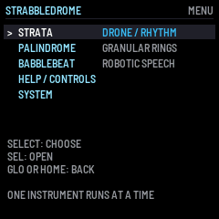
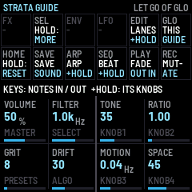

# STRABBLEDROME

**Three instruments in one firmware: STRATA, PALINDROME and BabbleBeat.** This page covers only how to move between them. Each instrument plays exactly as it does by itself, and has its own manual:

[STRATA](https://savageperson334.github.io/strata-fm1/manual/) · [PALINDROME](https://savageperson334.github.io/strata-fm1/palindrome/manual/) · [BabbleBeat](https://savageperson334.github.io/strata-fm1/babblebeat/manual/)

## Switching

1. Press **GLO**. The menu opens, from anywhere.
2. Turn **SELECT** to the instrument you want.
3. Press **SEL**. It starts.

To leave the menu without changing anything, press **GLO** or **HOME**.

| In the menu | Does |
| --- | --- |
| SELECT | Moves the highlight |
| SEL | Opens the highlighted row |
| GLO or HOME | Back to the instrument you were in |

Nothing is held, and no two buttons are pressed together.

## What happens when you switch

- **One instrument runs at a time.** Choosing another stops the first and starts the new one afresh, as if the FM-1 had just been switched on with it.
- **What you made in the one you left is gone**: PALINDROME's rings, BabbleBeat's words. STRATA's saved sound is kept, as always.
- **Opening the menu does not stop anything.** The instrument keeps sounding under the menu; it only stops when you open a different one.
- **Coming back to the same instrument** changes nothing: it is as you left it.

## While the menu is open

No key, knob or button reaches the instrument. Turn a knob in the menu and nothing changes when you go back.

## GLO inside an instrument

GLO is always the menu, so an instrument's own guide (held GLO, by itself) is reached another way: open the menu and choose **HELP / CONTROLS**. It shows the button guide of the instrument that is running. GLO, HOME or SEL closes it.

With no instrument open yet, HELP / CONTROLS shows this page's controls instead.

## The menu's rows

| Row | Opens |
| --- | --- |
| STRATA | The drone and rhythm instrument |
| PALINDROME | Three rings |
| BABBLEBEAT | The speaking instrument |
| HELP / CONTROLS | The running instrument's button guide |
| SYSTEM | The version, and which instruments are built in |

A `*` marks the instrument that is running.

## Status

An experimental prerelease: simulator-tested and built for the FM-1, playable [in the browser](../emu/), [installed from its page](../install/), and not yet run on a real FM-1. Every other control, sound and page belongs to the instrument you are in, and is described in its manual.
